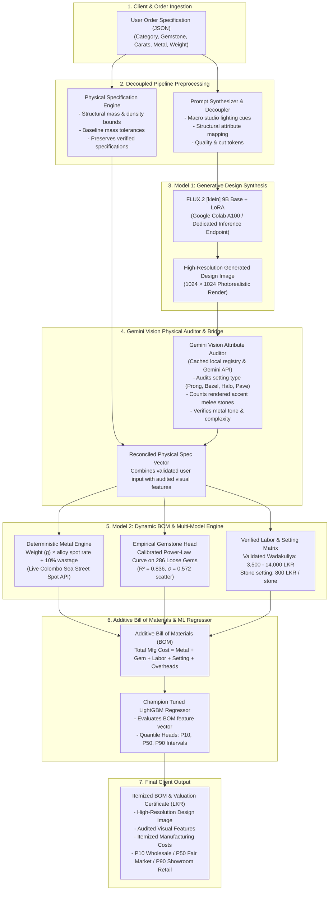

# Jewelry AI Platform: End-to-End System Implementation Architecture

This document specifies the end-to-end production architecture for the Generative Jewelry Design and Dynamic Valuation Platform. It details the data contracts, algorithmic modules, and integration pipelines connecting the **User Order Specification (JSON)** to **Model 1 (FLUX.2 Generative Diffusion)**, the **Gemini Vision Attribute Auditor Bridge**, and **Model 2 (Dynamic BOM & Multi-Model Valuation Engine)** in Sri Lankan Rupees (LKR).

---

## 1. High-Level Architectural Topology



---

## 2. Stage-by-Stage Implementation Details

### Stage 1: User Order Specification Schema (JSON)
The client interface submits a structured JSON payload representing customer requirements:

```json
{
  "order_id": "ORD-2026-8821",
  "category": "Ring",
  "gemstone": "Blue Sapphire",
  "gemstone_weight_ct": 2.50,
  "gemstone_cut": "cushion cut",
  "stone_grade": "AA (Fine Jewelry)",
  "color_grade": "Royal Blue",
  "treatment": "Heated",
  "metal": "22KT Gold",
  "metal_weight_g": 5.0,
  "setting_type": "Halo Prong",
  "design_complexity": "Complex",
  "number_of_accent_stones": 16
}
```

---

### Stage 2: Prompt Synthesizer & Physical Specification Engine

Two parallel engines consume the raw specification:

#### A. Prompt Synthesizer & Decoupler
Transforms raw database parameters into rich, photorealistic conditioning prompts calibrated for the fine-tuned FLUX.2 LoRA:
- **Removes internal accounting metadata** (prices, item IDs, inventory codes).
- **Injects professional macro jewelry lighting tokens**: `"macro studio photography, clean white background, softbox lighting, 8k resolution, razor sharp facets, dispersion highlights, luxury Sri Lankan fine jewelry craftsmanship"`.
- **Enforces precise gemstone appearance**: `"2.5 carat cushion cut royal blue Ceylon sapphire, vivid saturation, eye-clean clarity, secure micro-prong setting in solid 22KT yellow gold"`.

#### B. Physical Specification Engine
Validates physical reality and prevents impossible inputs before image generation:
- Verifies that metal mass meets minimum structural tolerances:
  - Rings: $2.5\text{g} \le \text{mass} \le 12.0\text{g}$
  - Earrings: $2.0\text{g} \le \text{mass} \le 14.0\text{g}$
  - Necklaces: $6.0\text{g} \le \text{mass} \le 45.0\text{g}$
- Validates density relationships: prevents user specifying an oversized $10\text{ct}$ gemstone mounted onto an impossibly flimsy $0.5\text{g}$ metal wire.

---

### Stage 3: Model 1 — Generative Design Synthesis (FLUX.2 LoRA)
- **Model**: FLUX.2 `[klein]` 9B Base with trained LoRA adapter.
- **Inference**: Generates a $1024 \times 1024$ photorealistic rendering matching the prompt.

---

### Stage 4: Gemini Vision Physical Attribute Auditor (Bridge)
- Rather than attempting to predict currency directly from raw pixels (which produces erratic financial predictions), the vision stream is strictly tasked with extracting discrete physical attributes:
  - **Setting Type**: Solitaire, Prong, Bezel, Halo, Pave, Channel.
  - **Accent Stone Count**: Counts rendered diamond/gemstone melee stones.
  - **Metal Tone**: Detected yellow gold, white gold, rose gold, or silver tone.
  - **Design Complexity**: Simple vs. Medium vs. Complex.
- **Implementation**: [`src/model2_cost/gemini_vision_bridge.py`](file:///e:/GIT/Jewelery%20Models%20Development/src/model2_cost/gemini_vision_bridge.py). Uses cached verified audits and live Gemini Vision API fallback.

---

### Stage 5: Model 2 — Dynamic BOM & Multi-Model Valuation Engine
1. **Deterministic Metal Engine**:
   $$\text{Metal Cost} = \text{Weight (g)} \times \text{Spot Rate/g} \times 1.10\text{ (Casting Wastage)}$$
2. **Empirical Gemstone Valuation Head**:
   Fitted on 286 real Ceylon gemstones with carat power-law scaling and natural market scatter ($\sigma = 0.572$):
   $$\ln(\text{Price}) = \beta_0 + \beta_1 \ln(\text{Carats}) + \sum \gamma_i \text{Treatment}_i + \sum \delta_j \text{Color}_j$$
3. **Verified Labor Matrix (*Wadakuliya*)**:
   - Rings: 3,500 – 4,500 LKR
   - Earrings: 4,000 – 5,000 LKR
   - Necklaces: 12,500 – 14,000 LKR
   - Stone Setting: 800 LKR per stone
4. **Champion Tuned LightGBM Regressor**:
   Evaluates the BOM feature vector against held-out showroom benchmarks, outputting expected fair market price and **[P10, P90]** commercial confidence intervals.

---

### Stage 6: Client Output & Certificate of Valuation
Outputs a structured certificate:
- **Audited Visual Attributes**: Setting style, accent stones, metal tone.
- **Itemized Bill of Materials (BOM)**: Exact breakdown of metal, center gemstone, *Wadakuliya* labor, and setting fees.
- **Commercial Valuation Interval**:
  - **P10 Wholesale Liquidation Floor** (LKR)
  - **P50 Fair Market Appraisal Price** (LKR)
  - **P90 Premium Showroom Boutique Ceiling** (LKR)
