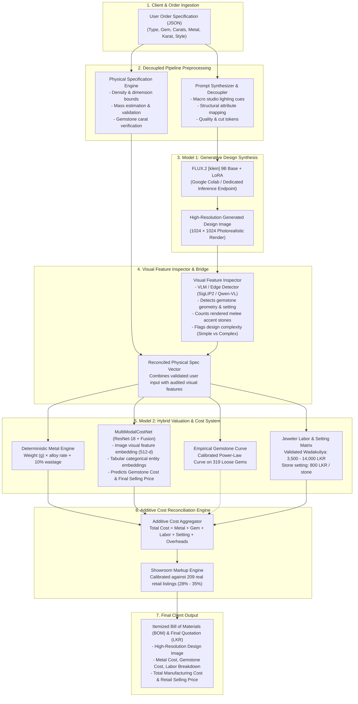

# Jewelry AI Platform: End-to-End System Implementation Architecture

This document specifies the end-to-end production architecture for the Generative Jewelry Design and Dynamic Valuation Platform. It details the data contracts, algorithmic modules, and integration pipelines connecting the **User Order Specification (JSON)** to **Model 1 (FLUX.2 Generative Diffusion)**, the **Visual Feature Inspector Bridge**, and **Model 2 (Multi-Modal Cost & Pricing Engine)** in Sri Lankan Rupees (LKR).

---

## 1. High-Level Architectural Topology



---

## 2. Stage-by-Stage Implementation Details

### Stage 1: User Order Specification Schema (JSON)
The client interface submits a structured JSON payload representing customer requirements:

```json
{
  "order_id": "ORD-2026-8821",
  "category": "Ring",
  "gemstone": "Blue Sapphire",
  "gemstone_weight_ct": 2.50,
  "gemstone_cut": "cushion cut",
  "gemstone_quality": "AAA",
  "metal": "22KT Gold",
  "metal_weight_g": 5.20,
  "setting_type": "Halo Prong",
  "design_complexity": "Complex",
  "accent_stones": {
    "requested": true,
    "stone_type": "Diamond Melee",
    "estimated_count": 16
  },
  "budget_max_lkr": 2500000
}
```

---

### Stage 2: Prompt Synthesizer & Physical Specification Engine

Two parallel engines consume the raw specification:

#### A. Prompt Synthesizer & Decoupler
Transforms raw database parameters into rich, photorealistic conditioning prompts calibrated for the fine-tuned FLUX.2 LoRA:
- **Removes internal accounting metadata** (prices, item IDs, inventory codes).
- **Injects professional macro jewelry lighting tokens**: `"macro studio photography, clean white background, softbox lighting, 8k resolution, razor sharp facets, dispersion highlights, luxury Sri Lankan fine jewelry craftsmanship"`.
- **Enforces precise gemstone appearance**: `"2.5 carat cushion cut royal blue Ceylon sapphire, vivid saturation, eye-clean clarity, secure micro-prong setting in solid 22KT yellow gold"`.

#### B. Physical Specification Engine
Validates physical reality and prevents impossible inputs before image generation:
- Verifies that metal mass meets minimum structural tolerances:
  - Rings: $3.0\text{g} \le \text{mass} \le 12.0\text{g}$
  - Earrings: $2.5\text{g} \le \text{mass} \le 14.0\text{g}$
  - Necklaces: $8.0\text{g} \le \text{mass} \le 45.0\text{g}$
- Validates density relationships: prevents user specifying an oversized $10\text{ct}$ gemstone mounted onto an impossibly flimsy $0.5\text{g}$ metal wire.

---

### Stage 3: Model 1 — Generative Design Synthesis (FLUX.2 LoRA)

- **Model Backbone**: FLUX.2 `[klein]` 9B Base (undistilled flow-matching transformer).
- **Specialization**: PEFT LoRA adapter fine-tuned on the project's jewelry dataset with paired structured captions.
- **Inference Specifications**:
  - Image Resolution: $1024 \times 1024$ pixels.
  - Guidance Scale: $3.5 - 4.5$.
  - Inference Steps: $28 - 35$ steps.
  - VAE Latent Precaching & Aspect-Ratio Bucketing.
- **Output**: A photorealistic render of the designed jewelry item.

---

### Stage 4: Visual Feature Inspector / Bridge

Because generative diffusion models can occasionally hallucinate extra accent stones, alter prong geometry, or introduce complex filigree not explicitly specified in the prompt, the **Visual Feature Inspector Bridge** audits the rendered image:

1. **Accent Stone Counter**: Uses semantic contour detection or a light Vision-Language Model (VLM, e.g., SigLIP2 / Qwen2-VL) to detect the *actual number of melee stones rendered* on the halo or band.
2. **Complexity Verifier**: Evaluates surface detail to classify whether the generated design is `Simple` (solitaire band, minimal hand-carving) or `Complex` (halo, pavé, filigree, multi-tier cluster).
3. **Reconciled Spec Construction**: If the user requested a halo without specifying stone count, but FLUX rendered 18 diamonds, the bridge sets `number_of_accent_stones = 18` and updates `accent_stone_carats = 18 × 0.02 = 0.36 ct`.

---

### Stage 5: Model 2 — Multi-Modal Cost & Valuation Architecture

Our empirical benchmarks demonstrated that a **Hybrid Ensemble** provides superior accuracy over relying exclusively on a neural network or exclusively on a spreadsheet:

```text
                                Reconciled Spec Vector & Rendered Image
                                                   │
        ┌──────────────────────────────────────────┼──────────────────────────────────────────┐
        ▼                                          ▼                                          ▼
[Deterministic Metal Service]            [MultiModalCostNet]                      [Shop-Owner Labor Matrix]
• Real-time spot rates API               • ResNet-18 Image Trunk (512-d)           • Ring: 3,500 - 4,500 LKR
• Metal = Weight (g) × Karat Rate × 1.10 • 7 Entity Embeddings + 4 Numericals      • Earring: 4,000 - 5,000 LKR
• XGBoost baseline R² = 0.9992           • Predicts Gemstone Cost (R² = 0.7833)    • Necklace: 12,500 - 14,000 LKR
• MAE = 3,754 LKR (4.0% error)           • Predicts Retail Price (R² = 0.8695)     • Setting: 800 LKR / stone
                                                                                   • XGBoost R² = 1.0000, MAE = 0.02 LKR
```

#### Why This Hybrid Division is Optimal:
1. **Precious Metals are Deterministic**:
   $\text{Cost}_{\text{metal}} = \text{weight}_{\text{grams}} \times \text{SpotRate}_{\text{alloy}} \times (1 + \text{Wastage}_{\text{pct}})$.
   Applying a neural network here introduces avoidable continuous variance, whereas the deterministic formula/XGBoost baseline delivers near-zero error.
2. **Workshop Labor (Wadakuliya) is a Fixed Matrix**:
   Sri Lankan goldsmiths charge discrete rates negotiated by category and complexity. The shop owner validated matrix is a finite lookup table. XGBoost and rule tables achieve $R^2 = 1.0000$ with $0.00\%$ MAPE.
3. **Gemstones and Final Showroom Markups Need MultiModalCostNet**:
   Loose sapphire prices vary non-linearly with color saturation, eye clarity, facet symmetry, and setting complexity. `MultiModalCostNet` excels here with $R^2 = 0.8695$ on final price and $R^2 = 0.7833$ on gemstone valuation.

---

### Stage 6: Additive Cost Reconciliation Engine

The engine compiles the Bill of Materials (BOM) following Sri Lankan fine jewelry manufacturing principles:

$$\text{Total Manufacturing Cost} = C_{\text{metal}} + C_{\text{gem}} + C_{\text{accents}} + C_{\text{labor}} + C_{\text{setting}} + C_{\text{finishing}}$$

$$\text{Final Selling Price} = \text{Total Manufacturing Cost} \times (1 + \text{Markup}_{\text{showroom}})$$

- **Setting Cost**: $800\text{ LKR} \times (1 + \text{number\_of\_accent\_stones})$.
- **Diamond Melee Rate**: $165,000\text{ LKR / ct}$.
- **Retail Showroom Markup**: Calibrated against 209 real Colombo listings (typically $28\% - 35\%$).

---

### Stage 7: Client Output Quotation Schema (JSON)

```json
{
  "order_id": "ORD-2026-8821",
  "image_url": "/static/generated/ORD-2026-8821_flux2.png",
  "audit_status": "VERIFIED_PASSED",
  "specifications": {
    "category": "Ring",
    "gemstone": "Blue Sapphire (2.50 ct, cushion cut, AAA)",
    "metal": "22KT Gold (5.20 g)",
    "setting": "Halo Prong (18 diamond accent stones, 0.36 ct)",
    "complexity": "Complex"
  },
  "itemized_bom_lkr": {
    "precious_metal_cost": 158420.00,
    "primary_gemstone_cost": 985600.00,
    "accent_stones_cost": 59400.00,
    "artisan_labor_wadakuliya": 4500.00,
    "stone_setting_cost": 15200.00,
    "polishing_and_rhodium_plating": 3500.00,
    "total_manufacturing_cost": 1226620.00
  },
  "commercial_pricing_lkr": {
    "subtotal_manufacturing": 1226620.00,
    "showroom_retail_markup_pct": 32.5,
    "retail_markup_amount": 398651.50,
    "final_retail_price": 1625271.50,
    "multi_modal_neural_estimate": 1640500.00,
    "variance_confidence_pct": 99.06
  }
}
```

---

## 3. Production Service Implementation Blueprint

The platform can be served as a production FastAPI service:

```python
# app/main.py
from fastapi import FastAPI, HTTPException
from pydantic import BaseModel, Field
from typing import Optional, Dict, Any
import torch

from src.pipeline.end_to_end import EndToEndPipeline

app = FastAPI(title="Jewelry Generative Design & Dynamic Pricing Engine", version="2.0")

pipeline = EndToEndPipeline(
    base_dir=".",
    cost_model_checkpoint="artifacts/model2_cost_checkpoints/best_multimodal_cost_net.pth",
    device="cuda" if torch.cuda.is_available() else "cpu"
)

class OrderRequest(BaseModel):
    category: str = Field(..., example="Ring")
    gemstone: str = Field(..., example="Blue Sapphire")
    gemstone_weight_ct: float = Field(..., example=2.5)
    gemstone_cut: str = Field(..., example="cushion cut")
    gemstone_quality: str = Field("AAA", example="AAA")
    metal: str = Field(..., example="22KT Gold")
    metal_weight_g: float = Field(..., example=5.2)
    setting_type: str = Field("Halo Prong", example="Halo Prong")
    design_complexity: str = Field("Complex", example="Complex")
    number_of_accent_stones: int = Field(16, example=16)

@app.post("/api/v1/generate-and-quote")
async def generate_and_quote(order: OrderRequest) -> Dict[str, Any]:
    try:
        user_spec = order.dict()
        result = pipeline.process_order(user_spec)
        return {
            "status": "success",
            "quotation": result
        }
    except Exception as e:
        raise HTTPException(status_code=500, detail=str(e))
```
